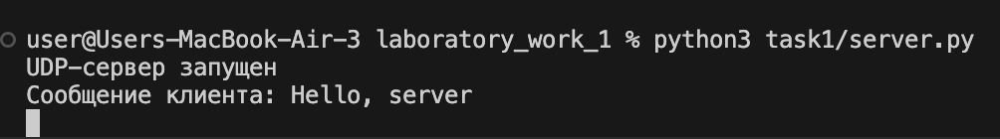
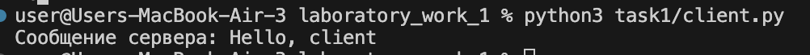
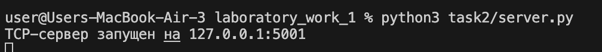
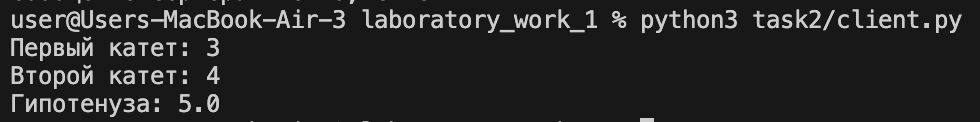
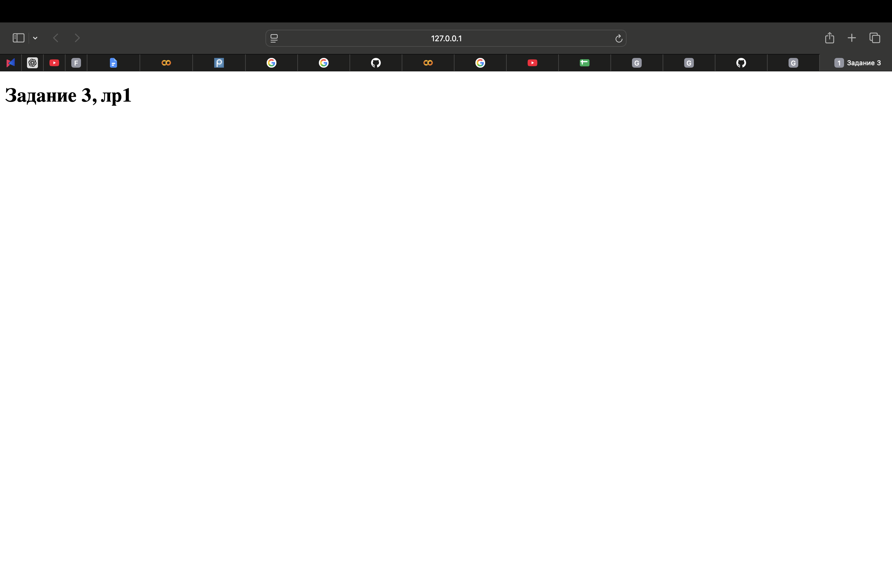
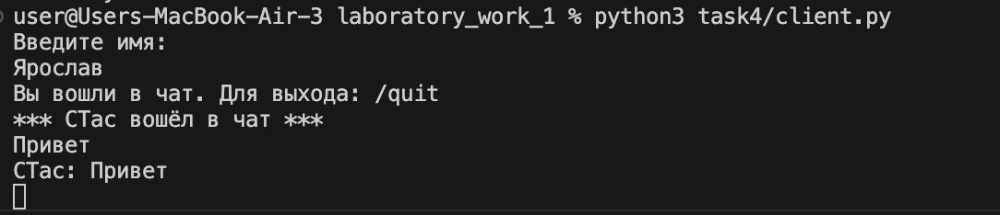
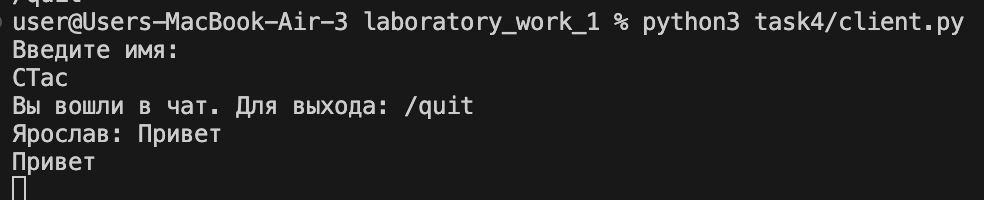
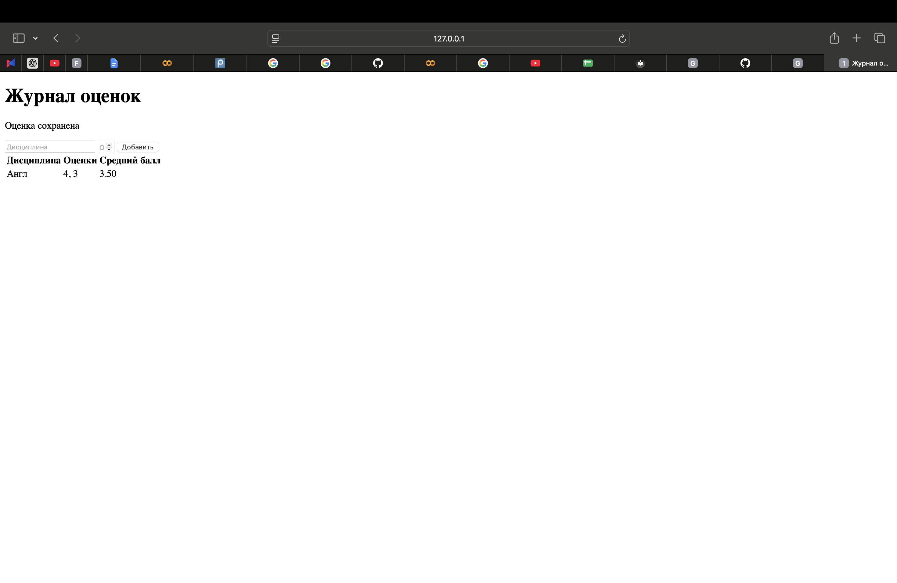

# Лабораторная работа №1. Работа с сокетами

**Выполнил:** Прудий Ярослав  
**Группа:** К3342

## Задание 1. Обмен сообщениями по UDP

UDP передаёт отдельные сообщения без установки постоянного соединения.

### Сервер

```python
import socket

HOST, PORT = "127.0.0.1", 5001


def run_server():
    with socket.socket(socket.AF_INET, socket.SOCK_DGRAM) as server:
        server.bind((HOST, PORT))
        print("UDP-сервер запущен")

        while True:
            data, address = server.recvfrom(4096)
            print("Сообщение клиента:", data.decode())
            server.sendto(b"Hello, client", address)


if __name__ == "__main__":
    run_server()
```

### Клиент

```python
import socket

HOST, PORT = "127.0.0.1", 5001


def run_client():
    with socket.socket(socket.AF_INET, socket.SOCK_DGRAM) as client:
        client.sendto(b"Hello, server", (HOST, PORT))
        data, _ = client.recvfrom(4096)
        print("Сообщение сервера:", data.decode())


if __name__ == "__main__":
    run_client()
```





## Задание 2. Вычисление гипотенузы по TCP

TCP устанавливает соединение и обеспечивает надёжную передачу данных.

### Сервер

```python
import math
import socket

HOST, PORT = "127.0.0.1", 5001


def run_server():
    with socket.socket(socket.AF_INET, socket.SOCK_STREAM) as server:
        server.bind((HOST, PORT))
        server.listen()

        while True:
            connection, _ = server.accept()

            with connection:
                a, b = map(float, connection.recv(1024).decode().split())
                connection.sendall(str(math.hypot(a, b)).encode())


if __name__ == "__main__":
    run_server()
```

### Клиент

```python
import socket

HOST, PORT = "127.0.0.1", 5001


def run_client():
    a = input("Первый катет: ")
    b = input("Второй катет: ")

    with socket.create_connection((HOST, PORT)) as client:
        client.sendall(f"{a} {b}".encode())
        print("Гипотенуза:", client.recv(1024).decode())


if __name__ == "__main__":
    run_client()
```





## Задание 3. Раздача HTML-страницы по HTTP

HTTP работает поверх TCP. Сервер принимает запрос браузера и возвращает HTML-страницу.

### Сервер

```python
import socket
from pathlib import Path

HOST, PORT = "127.0.0.1", 5001
PAGE = Path(__file__).with_name("index.html")


def run_server():
    body = PAGE.read_bytes()
    headers = (
        "HTTP/1.1 200 OK\r\n"
        "Content-Type: text/html; charset=utf-8\r\n"
        f"Content-Length: {len(body)}\r\n"
        "Connection: close\r\n\r\n"
    ).encode()

    with socket.socket(socket.AF_INET, socket.SOCK_STREAM) as server:
        server.bind((HOST, PORT))
        server.listen()

        while True:
            connection, _ = server.accept()

            with connection:
                connection.recv(1024)
                connection.sendall(headers + body)


if __name__ == "__main__":
    run_server()
```

### HTML-страница

```html
<!doctype html>
<html lang="ru">
<head>
  <meta charset="utf-8">
  <title>Задание 3</title>
</head>
<body>
  <h1>Задание 3, лр1</h1>
</body>
</html>
```



## Задание 4. Многопользовательский TCP-чат

Чат использует TCP. Для каждого клиента сервер создаёт отдельный поток.

### Сервер

```python
import socket
import threading

HOST, PORT = "127.0.0.1", 5001
clients = {}


def broadcast(message, sender=None):
    for client in list(clients):
        if client != sender:
            client.sendall((message + "\n").encode())


def handle_client(client):
    name = client.recv(1024).decode().strip()
    clients[client] = name
    broadcast(f"*** {name} вошёл в чат ***", client)

    while True:
        message = client.recv(4096).decode().strip()

        if not message or message == "/quit":
            break

        broadcast(f"{name}: {message}", client)

    del clients[client]
    client.close()


def run_server():
    with socket.socket(socket.AF_INET, socket.SOCK_STREAM) as server:
        server.bind((HOST, PORT))
        server.listen()

        while True:
            client, _ = server.accept()
            threading.Thread(target=handle_client, args=(client,)).start()


if __name__ == "__main__":
    run_server()
```

### Клиент

```python
import socket
import threading

HOST, PORT = "127.0.0.1", 5001


def receive_messages(client):
    while data := client.recv(4096):
        print(data.decode(), end="")


def run_client():
    name = input("Введите имя: ")

    with socket.create_connection((HOST, PORT)) as client:
        client.sendall(name.encode())
        threading.Thread(target=receive_messages, args=(client,), daemon=True).start()

        while True:
            message = input()
            client.sendall((message + "\n").encode())

            if message == "/quit":
                break


if __name__ == "__main__":
    run_client()
```





## Задание 5. Журнал оценок с GET/POST

GET получает страницу, POST отправляет оценку серверу. Данные хранятся в словаре только во время работы сервера.

### Сервер

```python
import socket
from pathlib import Path
from urllib.parse import parse_qs

HOST, PORT = "127.0.0.1", 5001
TEMPLATE = Path(__file__).with_name("index.html")


def render_page(grades):
    rows = "".join(
        f"<tr><td>{subject}</td><td>{', '.join(map(str, values))}</td>"
        f"<td>{sum(values) / len(values):.2f}</td></tr>"
        for subject, values in grades.items()
    ) or '<tr><td colspan="3">Оценок пока нет</td></tr>'

    page = TEMPLATE.read_text(encoding="utf-8")
    return page.replace("{{GRADE_ROWS}}", rows).encode()


def run_server():
    grades = {}

    with socket.socket(socket.AF_INET, socket.SOCK_STREAM) as server:
        server.bind((HOST, PORT))
        server.listen()

        while True:
            client, _ = server.accept()

            with client:
                request = client.recv(4096)
                head, body = request.split(b"\r\n\r\n", 1)
                method = head.decode().split()[0]

                if method == "POST":
                    form = parse_qs(body.decode())
                    subject = form["subject"][0]
                    grade = int(form["grade"][0])

                    if grade in range(2, 6):
                        grades.setdefault(subject, []).append(grade)

                page = render_page(grades)
                response = (
                    "HTTP/1.1 200 OK\r\n"
                    "Content-Type: text/html; charset=utf-8\r\n"
                    f"Content-Length: {len(page)}\r\n\r\n"
                ).encode()
                client.sendall(response + page)


if __name__ == "__main__":
    run_server()
```

### HTML-страница

```html
<!doctype html>
<html lang="ru">
<head>
  <meta charset="utf-8">
  <title>Журнал оценок</title>
</head>
<body>
  <h1>Журнал оценок</h1>
  {{NOTICE}}
  <form method="POST" action="/">
    <input name="subject" placeholder="Дисциплина" required>
    <input type="number" name="grade" placeholder="Оценка" min="2" max="5" required>
    <button type="submit">Добавить</button>
  </form>
  <table>
    <thead><tr><th>Дисциплина</th><th>Оценки</th><th>Средний балл</th></tr></thead>
    <tbody>{{GRADE_ROWS}}</tbody>
  </table>
</body>
</html>
```


